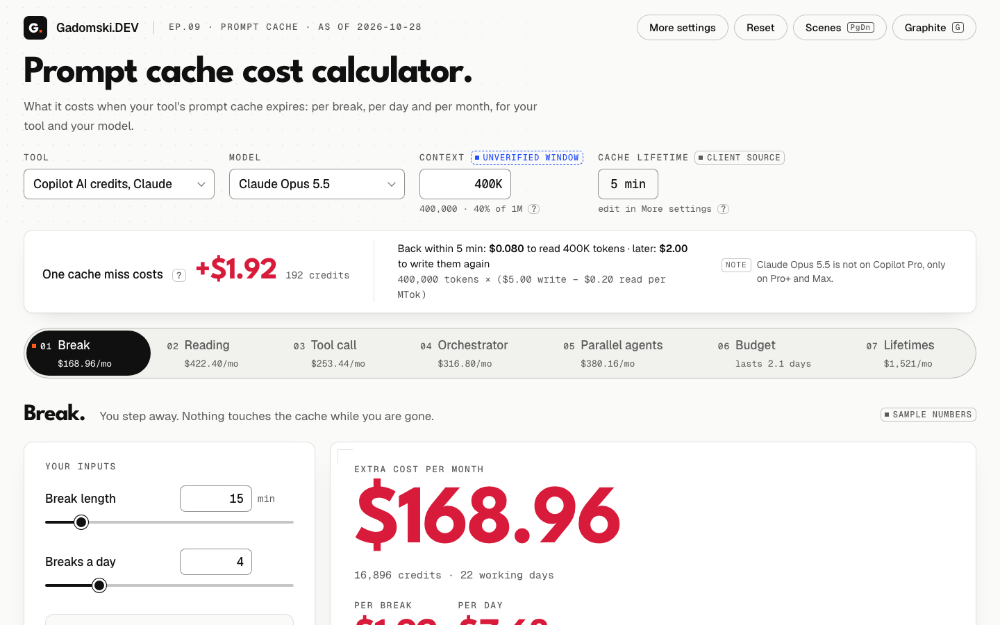

# Prompt cache cost calculator

What it costs when your AI coding tool's prompt cache expires: per break, per day and per month, in
GitHub Copilot, Cursor and Claude Code, for your tool and your model.

Built for episode 9 of [Gadomski.DEV](https://www.youtube.com/@GadomskiDEV) on YouTube, about what
an expired prompt cache costs and how to keep it warm.

## Open it

Download or clone the repository and double-click `index.html`. No build step, no dependencies,
no network: fonts are bundled in `fonts/`.

## How to read it

- **Pick your tool, model and context size** at the top. The header shows what one cache miss
  costs you; each tab below is one everyday situation where the cache expires (a break, reading
  the answer, a long test run, an orchestrator waiting on subagents, parallel agents, the monthly
  budget, and the same day under each cache lifetime).
- **The starting numbers are placeholders** for a heavy agent user. Set your own: each tab says
  "sample numbers" until you do.
- **Every price and cache lifetime carries a badge**: verified, from client source, community
  measured, "unverified - edit me", or "assumption - edit me". Hover a badge for its fact id;
  [`research/facts.md`](research/facts.md) holds the source and quote behind each one.
- **Every input lives in the URL hash**, so a copied link reopens the same configuration. Only
  values that differ from the defaults are written. **Reset** restores them.
- Token fields accept `400,000`, `400 000`, `400K` and `1.5M`.

## Prices go stale

Prices and cache lifetimes are as of 2026-10-28; the Cursor figures were rechecked on 2026-11-01.
When a vendor changes a price or a TTL, [open an issue](https://github.com/gadomski-dev/prompt-cache-calculator/issues)
with a link to the source.

Measured your own cache behaviour? The episode's polling fix (a short request every 3.5 minutes
keeps the cache warm) is documented for Claude Code only; nobody has measured it in Copilot or
Cursor yet. Results from either are welcome as issues.

## Presenting it

- **Recording mode** (button, or key `R`) hides every input and formula and shows only the big
  numbers of the selected tab, plus one line with its assumptions. The caveats stay visible.
  Keys `1`-`7` switch tab, `Esc` exits. The layout fits a 1920 x 1080 screen.
- **Scenes** (button, or `PgDn` / `PgUp`, which presentation clickers send) step through the
  configurations shown in the episode.
- **Graphite** (key `G`) switches to the dark edition.

## Files

| File | What it is |
|---|---|
| `index.html` | The page. Loads `model.js`; inline CSS and JS. |
| `model.js` | Pure maths, no DOM. Browser global `CacheModel`, Node `module.exports`. Constants copied from `research/constants.json` with status and fact ids (a `file://` page cannot fetch JSON). |
| `model.test.mjs` | `node:test` tests with hand-computed expected values for every scenario. Run `node --test model.test.mjs` (38 tests). |
| `research/` | `facts.md` (every fact id the page cites, with source and quote) and `constants.json` (the values `model.js` copies). |
| `fonts/` | League Spartan, Geist and Geist Mono, under the SIL Open Font License 1.1 (`fonts/LICENSE-*.txt`). |

## The core model

Units: USD per million tokens (MTok). C = the cached prefix in tokens (context window x fill %,
or an absolute number).

- **Gap** = generation time of the last turn + the idle minutes you enter. The TTL runs from the
  **start** of the previous request, so generation counts against it (F8). Default generation time
  1 minute (an assumption, "Generation time per turn"): 4.5 minutes of reading after a 1-minute
  answer is a 5.5-minute gap, so a miss.
- **Warm request** (gap since the last request on that prefix <= TTL): the prefix is billed at the
  read price, `C x read`.
- **Cold request** (gap > TTL): the whole prefix is billed at the write price of that TTL tier,
  `C x write`.
- New tokens of each turn are written at the write price either way, and output costs the same
  either way, so both drop out of every difference below.
- Providers without a write surcharge (GPT-5.3-Codex) write at base input.
- **Extra cost of one miss = C x (write - read).** This is the hero number in the header.
  Defaults: 400,000 x ($5.00 - $0.20) / 1M = **$1.92 = 192 AI credits**.
- **Long-context premium**: when the model has a long-context tier (Haiku 5.5 above 100K,
  GPT-5.6 Sol and GPT-6.1 Sol above 272K, GPT-5.6 Luna above 200K, facts F3, F46, F86) and the
  request is above the threshold, that tier's prices apply. The threshold is tested on C plus the
  new input of one turn ("New input per request" on the Monthly card), because it counts all input
  tokens (F3): a 100K Haiku 5.5 spoke is priced above 100K. Opus 5.5 has none (F6, F45, F63).
- **GPT hit rate**: on GPT the 30 minutes are a minimum eligibility window, not a guarantee (F80).
  Gaps of 5 minutes or less count as a sure hit; gaps above 5 minutes up to the TTL miss with
  probability 1 - hit rate. Default hit rate 77% (E4, 32,735 Copilot CLI calls; E2 measured ~95%
  after 11 minutes), editable as "GPT hit rate", badged "community-measured".
- **Two buckets**: main conversation and subagents each have a TTL and a write price. They differ
  only on the Claude Code subscription (main 1 h, subagents 5 min, F20).
- **AI credits** = USD / 0.01 (F41). Shown for the Copilot profiles.
- **Subscription**: marginal $0 inside the 5-hour limit (a simplification). The page shows
  the API-equivalent cost as the main number, coloured by misses and labelled "API-equivalent",
  because misses still burn the limit (E9). The Monthly card reads "Plan: flat fee".
- **Colours**: crimson = a cache miss, green = warm, ink = everything else. Dashed tiles and the
  "hypothetical" badge mark TTL tiers the model does not offer.

## Scenarios

All per-day numbers are multiplied by working days for the month.

1. **Break** - you leave for N minutes, k times a day.
   Extra per break = `C x (write - read)` if N > TTL, else 0. Per day = k x extra.
   Fix toggle ("announced break"): the agent polls every P minutes,
   see the poll formula below.
2. **Reading the answer** - you read the output for N minutes before replying, k times a day.
   Same formula as Break, no fix toggle.
3. **Long tool call** - tests or a build run N minutes, k runs a day.
   Fix toggle "background run + poll every P minutes":
   - polls = `ceil(gap / P) - 1` (only when the gap would miss);
   - one poll = `C x read + poll output x output + poll new input x write`;
   - cost with polling = polls x one poll; if P > TTL every poll misses too, and the final resume
     misses only if the rest after the last poll, `gap - polls x P`, is also over the TTL:
     cost = polls x (one poll + miss) + (rest > TTL ? miss : 0);
   - break-even polls = miss / one poll; polling is cheaper for gaps up to `ceil(break-even) x P`
     minutes: **80.5 min** with the agent-poll overhead (22.46 polls), **84 min** with a bare
     keep-alive read (24 polls). The card shows both.
   The card shows poll cost against miss cost as two bars.
4. **Orchestrator waiting on subagents** - cost of waiting and handoffs per run, in three layouts.
   `resume(C, gap)` = `C x read` if gap <= TTL, else `C x write`. Inputs: orchestrator context
   C_o, W waves of S parallel subagents, subagent duration D, subagent context C_s, tool wait
   inside each task, handoff file H, problems per run, rubber-duck discussion minutes, runs per day.
   - LLM hub-and-spoke = `W x resume(C_o, D)` [main] + `W x S x resume(C_s, wait)` [subagents]
     + per problem `H x write` (duck reads the handoff) + `resume(C_o, duck minutes)` [main].
     The hub misses once per wave when D > TTL.
   - Sequential single agent = `W x S x resume((C_s + C_o) / 2, wait)` [main] + per problem
     `H x write + resume((C_s + C_o) / 2, duck minutes)`. It still waits on every tool call, with a
     bigger context, so sequential does not fix it.
   - Orchestration in code = `W x S x resume(C_s, wait)` [subagents] + per problem
     `2 x H x write` (a fresh patcher and a duck start from the handoff file). No LLM hub waits.
   - Output and genuinely new input are the same in every layout at the 5-minute write price and are
     left out. On a longer-TTL bucket every context is written at a higher
     price, so each layout adds a premium line that is zero on 5-minute buckets: hub and sequential
     `C_o x (main write - 5-min write)`, hub and code `W x S x C_s x (subagent write - 5-min write)`
     (hub on 1 h = 0.4 x $3 = $1.20).
   - Every gap includes the generation time (D + 1, wait + 1, duck minutes + 1 by default).
   - Per day = runs x the layout picked in "Layout in my day". "Include in my day" adds only the
     re-write part (the `C x (write - read)` of the cold resumes) to Monthly budget.
5. **Parallel agents in worktrees** - N agents, R minutes with each in round-robin.
   Each agent waits `(N - 1) x R + generation`. Returns per hour = `60 / R`. Extra per hour =
   returns x `C_agent x (write - read)` if the wait > TTL. **Most agents you can rotate without a
   miss = floor((TTL - generation) / R) + 1.** Max minutes per agent at N = `(TTL - generation) / (N - 1)`.
   Worktrees never share a cache (F26). On GPT the dots turn orange: inside the window, but about
   23% of returns still miss.
6. **Monthly budget** - normal traffic plus the re-writes of every scenario marked
   "Include in my day".
   - C_avg = C x average prefix %.
   - Warm day = requests x (`C_avg x read + new x write + output x output price`).
   - Real day = warm day + included re-writes. Share of spend that is re-writes = re-writes / real day.
   - No caching = requests x (`(C_avg + new) x input + output x output price`).
   - Days the budget lasts = budget / per-day cost, with your TTL, with a warm cache, and with no caching.
   - Approximation: scenario events are counted among the requests at average prefix; only their
     re-write surcharge is added on top.

**TTL comparison** - the same day (included scenarios, before fixes) under each lifetime.
Each tile applies one TTL to both buckets and uses that tier's write price, per price tier (a
long-context request uses the long-context 5-minute or 1-hour write):
`sum of events x (gap > TTL ? C x (tile write - read) : 0)` + `tokens written per day x (tile write - your write)`
per bucket. Tokens written per day = the larger of `requests x new tokens` (Monthly card) and the
contexts the included scenarios build: main conversation C once, scenario 4 per layout and run,
scenario 5 N agents. Defaults: 400K + 400K + 12 x 100K + 5 x 180K = 2.9M tokens, so the 1-hour
premium is 2.9 x $3 = $8.70 a day (it was $2.40 on 0.8M of request traffic alone).
5 min uses the 5-minute write; 30 min is real for GPT-5.6+ and **hypothetical** at the 5-minute
price for Claude (Anthropic has no 30-minute tier); 1 h uses the 1-hour write; 5 min and 1 h are
hypothetical on GPT. Hypothetical tiles are dashed and carry a badge that stays visible in
recording mode. When main and subagent TTLs differ (Claude Code subscription), an extra **Your
setup** tile shows the real per-bucket day. **Agent poll** = an agent that polls every 4 minutes
at your TTL, priced like the poll above; 4 minutes is the interval of Anthropic's API keep-alive
(F14), and the tile note also gives the price of a bare F14 keep-alive (C x read only), which
Copilot, Cursor and Claude Code cannot send.

Fixes from the episode that fit these inputs are included: polling, code orchestration with a
fresh patcher from a handoff file, the 1-hour TTL (via the profile and the TTL comparison),
parallel-agent rhythm, a smaller context (via fill %) and the longest-cache model (via the Copilot
GPT profile). Not simulated: a handoff note before a break and a stable prefix, because they need
inputs this page does not have.

## Default numbers (placeholders for a heavy agent user; set your own)

Copilot AI credits with Claude Opus 5.5, 1M window at 40% (C = 400,000), TTL 5 min, 22 working
days, $200 budget.

| Scenario | Default inputs | Hero | Per day | Per month |
|---|---|---|---|---|
| One miss (header) | C = 400K | $1.92 (192 credits) | | |
| (all gaps below include 1 min of generation) | | | | |
| 1 Break | 15 min, 4 a day | $1.92 per break | $7.68 | $168.96 |
| 1 Break, polling on | P = 3.5 min, 4 polls | $0.34 per break | $1.37 | $30.10 |
| 2 Reading the answer | 8 min, 10 a day | $1.92 per reply | $19.20 | $422.40 |
| 3 Long tool call | 12 min, 6 runs | $1.92 per run | $11.52 | $253.44 |
| 3 Long tool call, polling on | P = 3.5 min, 3 polls | $0.26 per run | $1.54 | $33.86 |
| 4 Orchestrator | C_o 400K, 3 x 4 subagents of 100K, D 12, wait 7, H 80K, 1 problem of 8 min, 1 run | hub $14.40 per run; sequential $16.65; code $6.80 | $14.40 | $316.80 |
| 5 Parallel agents | 5 agents, 3 min each, 180K, 1 h a day | $17.28 per hour; largest warm N = 2 | $17.28 | $380.16 |
| 6 Monthly budget | 400 requests, 50% prefix, 2,000 new, 800 output | budget lasts 2.1 days (7.6 warm, 0.6 no caching); 72% of spend is re-writes | $95.52 | $2,101 (warm $580.80, no caching $7,251) |
| TTL comparison | agent poll every 4 min | 5 min $69.12/day; 30 min $0 (hypothetical); 1 h $8.70; agent poll $8.01 (bare keep-alive read $7.28) | | |

The orchestrator defaults describe one reference night of agent work ($14.40 for the hub).
On the Claude Code subscription the same inputs give hub $7.92, sequential $2.25, code $6.80
(API-equivalent): the 1-hour main TTL keeps the hub warm but writes its 400K at $8 instead of $5
(+$1.20), and subagents stay on 5 minutes, so code orchestration saves $1.12 per run. With an API
key on 1 h for both buckets: hub $6.00, sequential $2.49, code $5.12.

## Which constants are verified

Prices and TTLs come from `research/constants.json`; fact ids point at `research/facts.md`.

Verified (primary source):

- Anthropic prices for Opus 5.5, Sonnet 5.5, Haiku 5.5 (with long-context tier), Fable 5.1,
  Opus 5 / 4.8 / 4.5: F1-F7. Copilot and Cursor charge the same: F45, F63. Cursor Teams +$0.25/MTok
  on every category, Haiku 5.5 exempt: F64.
- GPT-5.6 Sol, GPT-6.1 Sol (up to 272K, and the $5.00 write above it), GPT-5.6 Luna, GPT-5.3-Codex
  rates in Copilot: F46, F80-F86.
- Which model rates each tool lists: Copilot F45 (Opus 5.5, Opus 5, Opus 4.8, Sonnet 5.5, Fable 5.1)
  and F46 (the four GPT models); Cursor F63 (Opus 5.5) and F71 (GPT-5.6 Sol); Cursor Teams F64
  (Opus 5.5). Every other tool + model pair is badged "unverified - edit me" (list price used).
- 1 AI credit = $0.01: F41.
- Claude Code TTL per bucket (subscription main 1 h, subagents 5 min; API 5 min; 1 h configurable): F20-F23.
- Copilot Claude 5 min (VS Code source and CLI logs, not stated by GitHub): K1, F52.
  Copilot GPT-5.6+ 30-minute minimum: K2, F52, F80. Cursor Claude 5 min (staff): K4, F65.

Shown with an "unverified - edit me" badge:

- **Context window of Claude inside Copilot** - not verified; a 540K session was measured
  (facts.md open question 2).
- **Context window of every GPT model** - null in constants.json; 1,000,000 is a placeholder.
- **Claude Code subscription main TTL of 60 min** - documented, but open regression #103673 reports
  5-minute writes in the interactive CLI since about 2026-10-14 (open question 4). Check `/usage`.
- **GPT-6 Astra prices in Copilot** - only the OpenAI API list price was checked (F85).
- **GPT-5.3-Codex TTL** - depends on the retention the client requests (F54, F83; open question 7).
- **GPT-6.1 Sol above 272K** - the $5.00 write is verified (F46); input $4.00 and read $0.20 are
  inferred from it (write = 1.25x input, F80; read 0.05x, F82), output $15.00 assumes 1.5x as on
  GPT-5.6 Sol (F86). Those three carry the badge and a warning appears.
- **Copilot TTLs** (5 min Claude, 30 min GPT) carry "from client source, not GitHub docs" (K1, K2,
  F52; GitHub's tutorial says 1 h, F53). **Cursor TTLs** carry "from staff forum posts, not docs"
  (F65, F66). Cursor GPT-5.3-Codex: older OpenAI models get up to 24 h there (F66).
- **Opus and Fable on Copilot Pro** - not available, only Pro+ and Max (F48); a warning appears.

Badged "assumption - edit me" (the calculator's own assumptions, not vendor facts):

- **Poll overhead (200 output + 300 new input tokens per poll)** - our estimate for a short poll turn.
- **Generation time per turn (1 min)** - F8 says it counts; the length is an assumption.

Badged "community-measured": **GPT hit rate 77%** for gaps of 5 minutes to the TTL (E4; E2 ~95%).

Not modelled (also stated on the Monthly card): Copilot plan allowances and discounts (F42, F43, F49), Cursor regional +10% and
US-only inference x1.1 (F12, F63), usage credits over the subscription limit (rate unverified,
open question 6), and whether a Copilot 1-hour write would be billed at 2x (open question 1).
Editing a field turns its badge into "your value"; editing a card's inputs turns its
"placeholder - set your own" badge into "your numbers".

## Licence

Code and documentation: MIT (`LICENSE`). Fonts: SIL Open Font License 1.1 (`fonts/LICENSE-*.txt`).
Prices and quotes in `research/` belong to their vendors and are cited with links.
